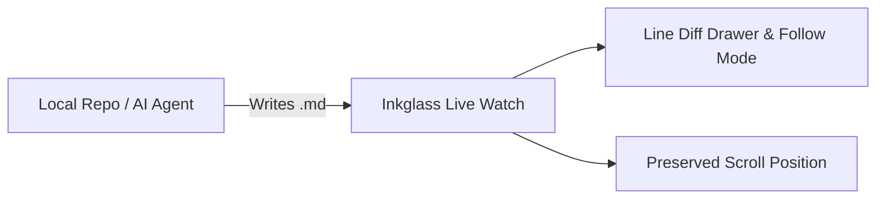

# Welcome to Inkglass 2.3

This sample file demonstrates how Inkglass renders living technical and research documentation completely offline.

> [!TIP]
> Edit this file in any external editor while it is open in Inkglass — Live Diff-Watch will reload it automatically, accumulate diffs until dismissed, let you inspect line-level `- / +` changes in **Show diff**, and optionally follow incoming edits.

> [!NOTE]
> Inkglass is strictly read-only. Opening a repository folder never creates hidden metadata files or alters your source Markdown.

## Technical Tables (Hover to Copy Clean CSV / TSV)

| Feature | Shortcut | Metric / Behavior |
| --- | --- | --- |
| Open Documents | `Ctrl+O` | Native Windows file dialog |
| Open Folder (Read-Only) | `Ctrl+Shift+O` | Filterable tree browser (depth 4 / 300 files) |
| Quick Jump | `Ctrl+K` | Fuzzy jump across headings, open docs, folder & recent |
| Copy Quote with Citation | `Ctrl+Shift+C` | Clean Markdown blockquote with `$R^2$` math intact |
| Export PDF | `Ctrl+P` | Light-paper print PDF (even from dark mode) |
| Always on Top | `Ctrl+Shift+T` | Floating reference window |

## Bundled Math ($L_2$ Loss & Inline `Alt+Click` Copy)

Inline math like $E = mc^2$ supports `Alt+Click` to copy its raw LaTeX expression, and display formulas include one-click raw `TeX` copying:

$$
\mathcal{L}(\theta) = -\frac{1}{N} \sum_{i=1}^{N} \log p_\theta(y_i \mid x_i)
$$

## Bundled Mermaid Diagrams (Click to Zoom & Copy SVG)

Source code and releases: [KennyMcSimpson/Inkglass](https://github.com/KennyMcSimpson/Inkglass).
